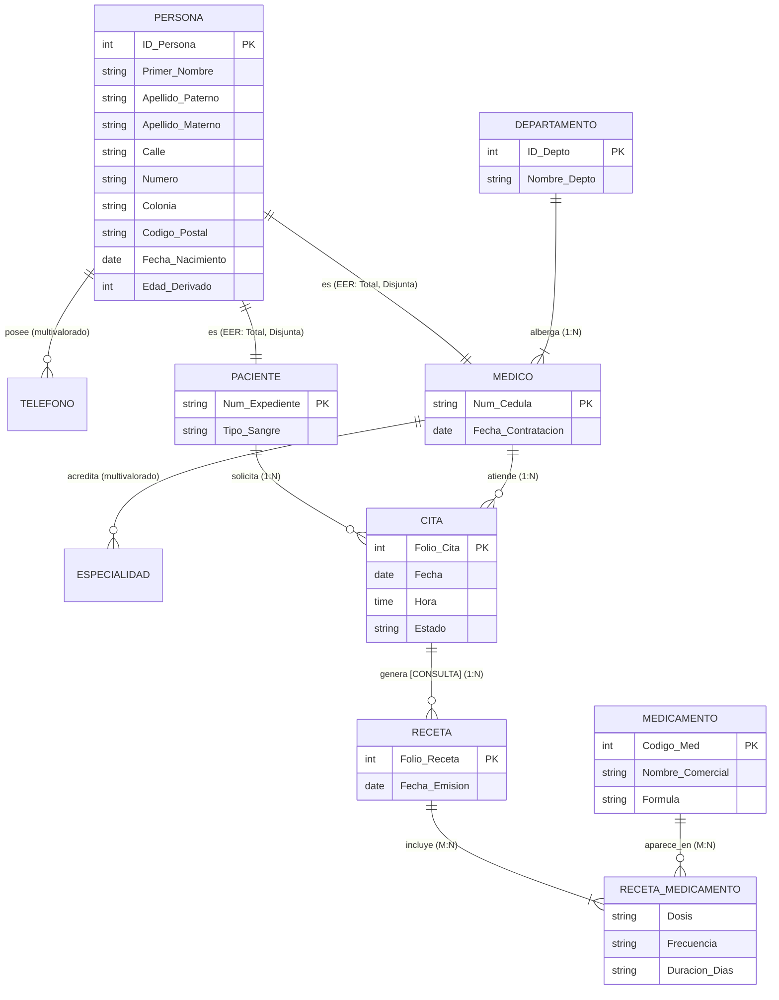

# Unidad-2-Dise-o-de-Bases-de-Datos-con-el-modelo-E-R
Unidad 2 
[reporte_tecnico_modelado_bd_clinica-v.1Revision.md](https://github.com/user-attachments/files/34098192/reporte_tecnico_modelado_bd_clinica-v.1Revision.md)
**CLÍNICA SALUD TOTAL - REPORTE TÉCNICO E-R / EER** 

**PÁGINA 1** 

<!-- Start of picture text -->
=aN —— > TECNOLOGICO NACIONAL DE MEXICO <!-- End of picture text -->

### **LICENCIATURA EN INFORMÁTICA** 

# **REPORTE TÉCNICO: MODELADO CONCEPTUAL E-R Y E-R EXTENDIDO** 

**Asignatura:** Sistemas de Bases de Datos **Docente** : Ruben Miguel Riojas Rodríguez **Alumno:** Eduardo Salazar Martínez **Fecha de Entrega:** 27 de octubre de 2026 

Materia: Bases de Datos | Unidad 2 

Documentación Técnica de Ingeniería 

**CLÍNICA SALUD TOTAL - REPORTE TÉCNICO E-R / EER** 

**PÁGINA 2** 

# **REPORTE TÉCNICO: MODELADO CONCEPTUAL** 

## **1. Planteamiento del Problema y Descripción Contextual** 

La institución médica **'Salud Total'** es un centro de atención ambulatoria y especializada que enfrenta ineficiencias operativas debido a la fragmentación de sus registros clínicos y administrativos. La coexistencia de expedientes físicos y hojas de cálculo independientes genera duplicidad de registros, dificultad para rastrear el historial de consultas de los pacientes, traslape en la agenda de citas de los médicos y falta de control estricto sobre los medicamentos prescritos. 

Para resolver esta problemática, se diseñó un modelo de base de datos relacional centralizado fundamentado en el **Modelo Entidad-Relación Extendido (EER)** . Este diseño permite consolidar la información de pacientes, personal médico, departamentos, agendas de citas, diagnósticos de consulta y emisión de recetas en un esquema estructurado que garantiza la integridad referencial, elimina redundancias y optimiza la toma de decisiones operativas. 

## **2. Reglas de Negocio Formales (RN)** 

- **RN-01 (Jerarquía de Personas):** Toda persona registrada en el sistema es clasificada de forma obligatoria y disjunta como Paciente o Médico. Cada persona posee un identificador único (ID_Persona), nombre completo, dirección de residencia, fecha de nacimiento y uno o más teléfonos de contacto. 

- **RN-02 (Expedientes de Pacientes):** Cada paciente cuenta con un número de expediente único y su tipo de sangre. La edad del paciente se calcula dinámicamente a partir de su fecha de nacimiento. 

- **RN-03 (Acreditación Médica):** Cada médico posee una cédula profesional única, fecha de contratación y puede acreditar una o varias especialidades médicas. 

- **RN-04 (Estructura Departamental):** La clínica se organiza en departamentos médicos. Un departamento alberga uno o varios médicos; cada médico pertenece obligatoriamente a un único departamento. 

- **RN-05 (Programación de Citas):** Un paciente puede solicitar múltiples citas a lo largo del tiempo, y un médico atiende múltiples citas. Cada cita almacena un folio único, fecha, hora y estado (Programada, Completada, Cancelada). 

- **RN-06 (Agregación - Consulta Médica):** La atención efectiva derivada de una cita entre un paciente y un médico constituye la Consulta Médica, de la cual se registra el diagnóstico y costo base. 

- **RN-07 (Emisión de Recetas):** A partir de una consulta médica se emite una o más recetas médicas identificadas por folio de receta y fecha de emisión. 

- **RN-08 (Prescripción de Medicamentos):** Una receta incluye uno o varios medicamentos. Para cada medicamento recetado se especifican dosis, frecuencia y duración en días del tratamiento. 

Materia: Bases de Datos | Unidad 2 

Documentación Técnica de Ingeniería 

**CLÍNICA SALUD TOTAL - REPORTE TÉCNICO E-R / EER** 

**PÁGINA 3** 

## **3. Identificación de Componentes del Modelo E-R** 

|**Entidad**|**Clave Primaria** **(PK)**|**Atributos Simples**|**Atributo Compuesto**|**Atributo** **Derivado**|**Atributo** **Multivalorado**|
|---|---|---|---|---|---|
|Persona (Super)|ID_Persona|Fecha_Nacimiento|Nombre_Completo, Dirección|Edad (calculado)|Teléfono|
|Paciente (Sub)|Num_Expediente|Tipo_Sangre|Heredados de Persona|Heredados de Persona|Heredados de Persona|
|Médico (Sub)|Num_Cédula|Fecha_Contratación|Heredados de Persona|Heredados de Persona|Especialidad|
|Departamento|ID_Depto|Nombre_Depto, Ubicación|N/A|N/A|N/A|
|Cita|Folio_Cita|Fecha, Hora, Estado|N/A|N/A|N/A|
|Consulta|ID_Consulta|Diagnóstico, Costo_Base|N/A|N/A|N/A|
|Receta|Folio_Receta|Fecha_Emisión|N/A|N/A|N/A|
|Medicamento|Código_Med|Nombre_Comercial, Fórmula|N/A|N/A|N/A|

## **4. Aplicación del Modelo E-R Extendido (EER)** 

**A. Jerarquía de Especialización / Generalización:** Se definió la superclase PERSONA y las subclases PACIENTE y MÉDICO. Se aplica una restricción de **Disyunción (d)** porque una instancia no puede ser médico y paciente al mismo tiempo, y una restricción de **Completitud Total (t)** ya que toda persona debe pertenecer obligatoriamente a una de las dos subclases. 

**B. Abstracción por Agregación:** La relación entre PACIENTE, MÉDICO y CITA genera el hecho abstracto CONSULTA MÉDICA, conectando directamente la atención con la emisión de RECETAS mediante la relación (1:N) Prescribe, evitando relaciones ternarias complejas. 

Materia: Bases de Datos | Unidad 2 

Documentación Técnica de Ingeniería 

**CLÍNICA SALUD TOTAL - REPORTE TÉCNICO E-R / EER** 

**PÁGINA 4** 

## **5. Diagramas Formales del Modelo E-R y EER** 

**Figura 1.** Diagrama Entidad-Relación Completo del Sistema Clínica Salud Total. 

<!-- Start of picture text -->
DIAGRAMA CONCEPTUAL ENTIDAD-RELACION COMPLETO (E-R) Ctinice Salud Total -Modelo de Datos = = eater >> <ntinte > < enim > Cereserta)> Centura > p=kK > =~ kK >| =- kK > —— | (SSE Ea) <!-- End of picture text -->

**Figura 2.** Detalle del Modelo E-R Extendido: Jerarquía Persona y Agregación Consulta. 

<!-- Start of picture text -->
DETALLE EER: ESPECIALIZACION Y AGREGACION De: )«|6( nnn H Especializacién Disjunta y Total (d, t) 1 4 Abstraccién por Agregacién (CONSULTA) H ' Hin1 1 H q H H hot F 4 H | ee | 1 ot CONSULTA MEDICA (Agregacisn) pt H fot ia i +. | ie pot 1 (ess) 1;i so: i PACIENTE. FfPoa7 H hot F 4 H [| l=) 1i '| e 1 i_ 'i 1 1 q SESE SUScUSESECnOEEREORSEESRUGEEEEONnESenecE!1 «© iOCCU UES EEC Ni is emensnnesemeLccusouuensonecaee! q <!-- End of picture text -->

Materia: Bases de Datos | Unidad 2 

Documentación Técnica de Ingeniería 

**CLÍNICA SALUD TOTAL - REPORTE TÉCNICO E-R / EER** 

**PÁGINA 5** 

## **6. Diccionario de Datos Completo del Sistema** 

El diccionario de datos especifica la estructura física, tipos de datos, longitudes, restricciones de integridad y descripción semántica de las tablas derivadas del modelo relacional: 

**Tabla 1: PERSONA (Superclase de Entidad)** 

|**Nombre Campo**|**Tipo Dato**|**Longitud**|**Nulo**|**Clave**|**Restricciones / Default**|**Descripción Semántica**|
|---|---|---|---|---|---|---|
|ID_Persona|INT|4 bytes|NO|PK|AUTO_INCREMENT > 0|Identificador único de la persona.|
|Primer_Nombre|VARCHAR|50|NO|Ninguna|Sin números ni símbolos|Primer nombre de la persona.|
|Apellido_Paterno|VARCHAR|50|NO|Ninguna|Texto alfabético|Primer apellido de la persona.|
|Apellido_Materno|VARCHAR|50|SÍ|Ninguna|Texto alfabético|Segundo apellido de la persona.|
|Calle|VARCHAR|100|NO|Ninguna|Dirección física|Nombre de la calle de residencia.|
|Numero|VARCHAR|20|NO|Ninguna|Alfanumérico|Número exterior e interior.|
|Colonia|VARCHAR|100|NO|Ninguna|Texto|Colonia o fraccionamiento.|
|Codigo_Postal|VARCHAR|10|NO|Ninguna|Formato postal local|Código postal de residencia.|
|Fecha_Nacimiento|DATE|3 bytes|NO|Ninguna|CHECK (Fecha < Actual)|Fecha de nacimiento.|
|Edad_Derivado|INT|4 bytes|SÍ|Derivado|Calculado dinámicamente|Edad en años a la fecha actual.|

**Tabla 2: PERSONA_TELEFONO (Atributo Multivalorado)** 

|**Nombre Campo**|**Tipo Dato**|**Longitud**|**Nulo**|**Clave**|**Restricciones / Default**|**Descripción Semántica**|
|---|---|---|---|---|---|---|
|ID_Persona|INT|4 bytes|NO|PK / FK|FK -> PERSONA(ID_Persona)|Identificador de la persona.|
|Telefono|VARCHAR|15|NO|PK|Dígitos de contacto|Número telefónico de contacto.|
|**Tabla 3: PACIE** **Nombre Campo**|**NTE (Subcla** **Tipo Dato**|**se de PE** **Longitud**|**RSONA)** **Nulo**|**Clave**|**Restricciones / Default**|**Descripción Semántica**|
|Num_Expediente|VARCHAR|20|NO|PK|Formato 'EXP-YYYY-XXXX'|Número único de expediente clínico.|
|ID_Persona|INT|4 bytes|NO|FK / UNQ|FK -> PERSONA(ID_Persona)|Vínculo con la superclase persona.|
|Tipo_Sangre|VARCHAR|5|NO|Ninguna|CHECK in ('A+','A-','O+','O-',...)|Grupo sanguíneo y factor Rh.|

**Tabla 3: PACIENTE (Subclase de PERSONA)** 

Materia: Bases de Datos | Unidad 2 

Documentación Técnica de Ingeniería 

**CLÍNICA SALUD TOTAL - REPORTE TÉCNICO E-R / EER** 

**PÁGINA 6** 

**Tabla 4: MEDICO (Subclase de PERSONA)** 

|**Nombre Campo**|**Tipo Dato**|**Longitud**|**Nulo**|**Clave**|**Restricciones / Default**|**Descripción Semántica**|
|---|---|---|---|---|---|---|
|Num_Cedula|VARCHAR|20|NO|PK|Cédula profesional|Cédula profesional del médico.|
|**Nombre Campo**|**Tipo Dato**|**Longitud**|**Nulo**|**Clave**|**Restricciones / Default**|**Descripción Semántica**|
|ID_Persona|INT|4 bytes|NO|FK / UNQ|FK -> PERSONA(ID_Persona)|Vínculo con la superclase persona.|
|Fecha_Contratacion|DATE|3 bytes|NO|Ninguna|CHECK (Fecha <= Actual)|Fecha de ingreso a la clínica.|
|ID_Depto|INT|4 bytes|NO|FK|FK -> DEPARTAMENTO(ID_ Depto)|Departamento al que pertenece.|

**Tabla 5: MEDICO_ESPECIALIDAD (Atributo Multivalorado)** 

|**Nombre Campo**|**Tipo Dato**|**Longitud**|**Nulo**|**Clave**|**Restricciones / Default**|**Descripción Semántica**|
|---|---|---|---|---|---|---|
|Num_Cedula|VARCHAR|20|NO|PK / FK|FK -> MEDICO(Num_Cedula)|Cédula profesional del médico.|
|Especialidad|VARCHAR|50|NO|PK|Texto académico|Nombre de la especialidad acreditada.|

**Tabla 6: DEPARTAMENTO** 

|**Nombre Campo**|**Tipo Dato**|**Longitud**|**Nulo**|**Clave**|**Restricciones / Default**|**Descripción Semántica**|
|---|---|---|---|---|---|---|
|ID_Depto|INT|4 bytes|NO|PK|AUTO_INCREMENT|Identificador del departamento.|
|Nombre_Depto|VARCHAR|100|NO|UNIQUE|Texto único|Nombre del departamento clínico.|
|Ubicacion|VARCHAR|100|SÍ|Ninguna|Texto libre|Piso o ala dentro de la clínica.|

**Tabla 7: CITA** 

|**Nombre Campo**|**Tipo Dato**|**Longitud**|**Nulo**|**Clave**|**Restricciones / Default**|**Descripción Semántica**|
|---|---|---|---|---|---|---|
|Folio_Cita|INT|4 bytes|NO|PK|AUTO_INCREMENT|Folio único de la cita médica.|
|Fecha|DATE|3 bytes|NO|Ninguna|Fecha programada|Día asignado para la consulta.|
|Hora|TIME|3 bytes|NO|Ninguna|Horario laboral|Hora programada para la cita.|
|Estado|VARCHAR|20|NO|Ninguna|DEFAULT 'Programada'|Estado (Programada/Com pletada/Cancelada).|
|Num_Expediente|VARCHAR|20|NO|FK|FK -> PACIENTE(Num_Expe diente)|Paciente que solicita la cita.|
|Num_Cedula|VARCHAR|20|NO|FK|FK -> MEDICO(Num_Cedula)|Médico asignado para la cita.|

Materia: Bases de Datos | Unidad 2 

Documentación Técnica de Ingeniería 

**CLÍNICA SALUD TOTAL - REPORTE TÉCNICO E-R / EER** 

**PÁGINA 7** 

**Tabla 8: CONSULTA (Agregación)** 

|**Nombre Campo**|**Tipo Dato**|**Longitud**|**Nulo**|**Clave**|**Restricciones / Default**|**Descripción Semántica**|
|---|---|---|---|---|---|---|
|ID_Consulta|INT|4 bytes|NO|PK|AUTO_INCREMENT|Identificador de la consulta médica.|
|Folio_Cita|INT|4 bytes|NO|FK / UNQ|FK -> CITA(Folio_Cita)|Cita que origina la consulta.|
|Diagnostico|TEXT|Variable|NO|Ninguna|Min. 10 caracteres|Diagnóstico clínico detallado.|
|**Nombre Campo**|**Tipo Dato**|**Longitud**|**Nulo**|**Clave**|**Restricciones / Default**|**Descripción Semántica**|
|Costo_Base|DECIMAL|10,2|NO|Ninguna|CHECK (Costo_Base >= 0)|Costo financiero de la consulta.|

#### **Tabla 9: RECETA** 

|**Nombre Campo**|**Tipo Dato**|**Longitud**|**Nulo**|**Clave**|**Restricciones / Default**|**Descripción Semántica**|
|---|---|---|---|---|---|---|
|Folio_Receta|INT|4 bytes|NO|PK|AUTO_INCREMENT|Folio único de la receta médica.|
|ID_Consulta|INT|4 bytes|NO|FK|FK -> CONSULTA(ID_Consulta)|Consulta donde se emite la receta.|
|Fecha_Emision|DATE|3 bytes|NO|Ninguna|DEFAULT CURRENT_DATE|Fecha de emisión de la receta.|

#### **Tabla 10: MEDICAMENTO** 

|**Nombre Campo**|**Tipo Dato**|**Longitud**|**Nulo**|**Clave**|**Restricciones / Default**|**Descripción Semántica**|
|---|---|---|---|---|---|---|
|Codigo_Med|INT|4 bytes|NO|PK|AUTO_INCREMENT|Código interno del medicamento.|
|Nombre_Comercial|VARCHAR|100|NO|Ninguna|Texto comercial|Nombre de marca del medicamento.|
|Formula|VARCHAR|200|NO|Ninguna|Sustancia activa|Composición química o fórmula.|

**Tabla 11: RECETA_MEDICAMENTO (Relación M:N)** 

|**Nombre Campo**|**Tipo Dato**|**Longitud**|**Nulo**|**Clave**|**Restricciones / Default**|**Descripción Semántica**|
|---|---|---|---|---|---|---|
|Folio_Receta|INT|4 bytes|NO|PK / FK|FK -> RECETA(Folio_Receta)|Receta que incluye el medicamento.|
|Codigo_Med|INT|4 bytes|NO|PK / FK|FK -> MEDICAMENTO(Codi go_Med)|Medicamento prescrito.|
|Dosis|VARCHAR|100|NO|Ninguna|Ej. '500 mg'|Cantidad por toma prescrita.|
|Frecuencia|VARCHAR|100|NO|Ninguna|Ej. 'Cada 8 horas'|Intervalo de administración.|
|Duracion_Dias|INT|4 bytes|NO|Ninguna|CHECK (Duracion_Dias > 0)|Días totales del tratamiento.|

Materia: Bases de Datos | Unidad 2 

Documentación Técnica de Ingeniería 

**CLÍNICA SALUD TOTAL - REPORTE TÉCNICO E-R / EER** 

**PÁGINA 8** 

## **7. Justificación Técnica del Diseño** 

El diseño del modelo conceptual y diccionario de datos responde a criterios estrictos de ingeniería de bases de datos: 1. **Normalización Inicial (1FN):** Los atributos multivalorados (Teléfonos y Especialidades) se descompusieron en tablas satélite subordinadas, eliminando grupos repetitivos dentro de las entidades principales. 

2. **Mantenibilidad de la Jerarquía:** La especialización de Persona consolida atributos comunes en una sola entidad, evitando duplicar nombres y direcciones en tablas independientes para médicos y pacientes. 

3. **Integridad de Prescripción:** La abstracción de Consulta mediante agregación garantiza que las recetas se emitan únicamente en el marco de una atención médica confirmada, asegurando trazabilidad legal y clínica. 

Materia: Bases de Datos | Unidad 2 

Documentación Técnica de Ingeniería 

**CLÍNICA SALUD TOTAL - REPORTE TÉCNICO E-R / EER** 

**PÁGINA 9** 

## **8. Referencias Bibliográficas (Formato APA 7.ª Edición)** 

- **Coronel, C., & Morris, S.** (2019). _Database Systems: Design, Implementation, & Management_ (13th ed.). Cengage Learning. 

- **Date, C. J.** (2004). _An Introduction to Database Systems_ (8th ed.). Pearson Addison-Wesley. 

- **Elmasri, R., & Navathe, S. B.** (2017). _Fundamentos de sistemas de bases de datos_ (7.ª ed.). Pearson Educación. 

- **Object Management Group.** (2017). _Unified Modeling Language (UML) Specification_ (Version 2.5.1). OMG. 

- **Silberschatz, A., Korth, H. F., & Sudarshan, S.** (2014). _Fundamentos de bases de datos_ (6.ª ed.). McGraw-Hill Education. 

Materia: Bases de Datos | Unidad 2 

Documentación Técnica de Ingeniería 

